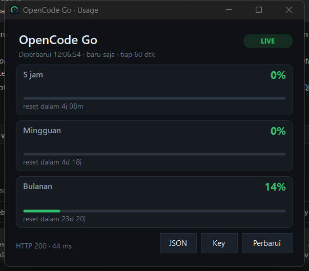
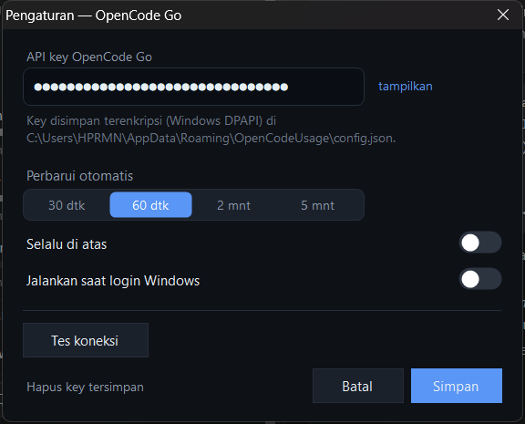
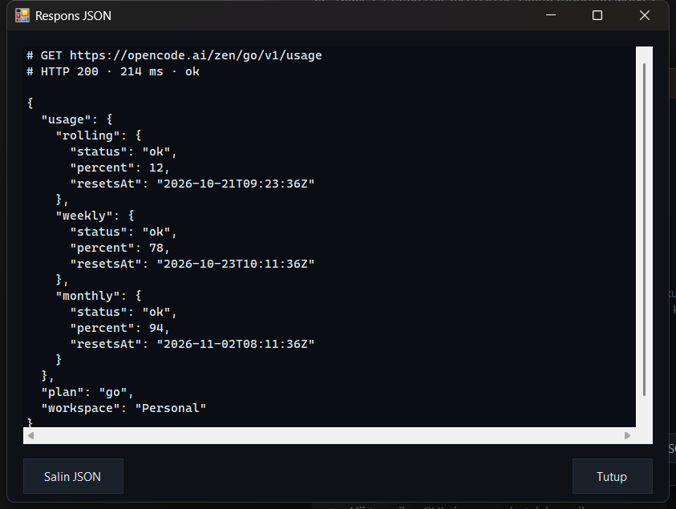
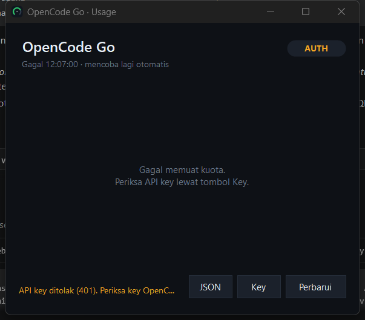

# OpenCode Go Usage (Windows)

Aplikasi desktop kecil untuk memantau pemakaian kuota **OpenCode Go** langsung dari
Windows, tanpa membuka browser. Cukup tempel API key sekali, lalu kuota 5 jam,
mingguan, dan bulanan selalu terlihat di jendela kecil atau di system tray.



---

## Isi

- [Fitur](#fitur)
- [Menjalankan](#menjalankan)
- [Mengatur API key](#mengatur-api-key)
- [Sumber data](#sumber-data)
- [Mode baris perintah](#mode-baris-perintah)
- [Pemecahan masalah](#pemecahan-masalah)
- [Keamanan](#keamanan)
- [Build dari sumber](#build-dari-sumber)
- [Struktur proyek](#struktur-proyek)
- [Alat bantu uji](#alat-bantu-uji)
- [Alternatif yang sudah ada](#alternatif-yang-sudah-ada)

---

## Fitur

| Fitur | Keterangan |
| --- | --- |
| Tiga jendela kuota | `rolling` (5 jam), `weekly` (mingguan), `monthly` (bulanan) dengan persen terpakai dan hitung mundur reset |
| Warna status | hijau < 70%, kuning 70–89%, merah ≥ 90% |
| Refresh otomatis | default 60 detik (bisa 30 dtk / 60 dtk / 2 mnt / 5 mnt); saat gagal dicoba ulang tiap 30 detik |
| System tray | ikon tray dengan tooltip `5j 12% · mgg 78% · bln 94%`, klik dua kali untuk membuka |
| Tombol X | menyembunyikan jendela ke tray (bukan keluar). Keluar lewat menu tray → **Keluar** |
| Selalu di atas | bisa diaktifkan dari tray atau Pengaturan |
| Mulai saat login | opsional (menulis entri `HKCU\...\Run`) |
| Lihat JSON | tombol **JSON** menampilkan respons mentah (endpoint, status HTTP, durasi) |
| Tes koneksi | di dialog Pengaturan, untuk memastikan key valid sebelum disimpan |
| Mode CLI | `--once` mencetak ringkasan ke konsol, cocok untuk skrip/otomasi |
| Tanpa instalasi | satu file `.exe`, memakai .NET Framework 4.8 bawaan Windows 10/11 |

Dialog pengaturan dan lihat JSON:

| Pengaturan | Respons JSON | Contoh error (key ditolak) |
| --- | --- | --- |
|  |  |  |

---

## Menjalankan

1. Jalankan `dist\OpenCodeUsage.exe` (klik dua kali).
2. Klik **Key**, tempel API key OpenCode Go, klik **Simpan**.
3. Selesai. Kuota muncul dan diperbarui otomatis.

Tidak perlu Python, Node, atau runtime tambahan: Windows 10/11 sudah punya
.NET Framework 4.8 yang dipakai aplikasi ini.

> Aplikasi hanya berjalan satu instance. Kalau dijalankan lagi, muncul pemberitahuan
> bahwa aplikasi sudah ada di system tray.

### Kalau muncul "Windows protected your PC"

Jendela biru SmartScreen itu **bukan virus**. Windows menandainya karena `.exe` ini
tidak ditandatangani secara digital dan berasal dari unduhan (ada tanda *Mark of the
Web*). Tiga cara menghilangkannya, pilih salah satu:

1. Klik **More info** → **Run anyway** (cukup sekali per file).
2. Hapus penanda unduhannya, lalu jalankan lagi:
   ```powershell
   Unblock-File -Path .\OpenCodeUsage.exe
   ```
   (atau klik kanan file → Properties → centang **Unblock** → OK)
3. Build sendiri dari sumber (lihat [Build dari sumber](#build-dari-sumber)).
   Hasil build lokal tidak pernah memicu SmartScreen.

Cek sidik jari file sebelum dipakai:

```powershell
Get-FileHash .\OpenCodeUsage.exe -Algorithm SHA256
# EB87D6C73FC0CA84DC0F855A875074B09B541F0DF1AE7E0F7FC494F9C23F818E
```

Kalau hash-nya sama dengan di atas, isinya persis file yang dihasilkan `build.ps1`.
(SmartScreen hilang permanen hanya kalau `.exe` ditandatangani dengan sertifikat
code-signing berbayar — untuk aplikasi pribadi, langkah 1–3 sudah cukup.)

## Mengatur API key

Key dibaca dengan urutan berikut (yang pertama ditemukan dipakai):

1. **Key yang disimpan di aplikasi** — dienkripsi dengan Windows DPAPI milik user,
   berlokasi di `%APPDATA%\OpenCodeUsage\config.json`.
2. Variabel lingkungan `OPENCODE_GO_API_KEY`
3. Variabel lingkungan `OPENCODE_API_KEY`
4. `auth.json` milik opencode (entri `opencode-go` lebih diutamakan daripada `opencode`),
   dicari di `%LOCALAPPDATA%\opencode\`, `%APPDATA%\opencode\`, `~\.local\share\opencode\`,
   `~\.config\opencode\`, dan `%XDG_DATA_HOME%\opencode\`.

Artinya: kalau kamu sudah pernah `opencode auth login`, aplikasi ini biasanya langsung
jalan tanpa perlu menempel key manual. Kalau key disimpan manual, key itulah yang dipakai;
gunakan tautan **Hapus key tersimpan** di Pengaturan untuk kembali ke deteksi otomatis.

Ambil key di [opencode.ai/console](https://opencode.ai/console) (butuh langganan Go atau Go Plus).

## Sumber data

```
GET https://opencode.ai/zen/go/v1/usage
Authorization: Bearer <API key OpenCode Go>
```

Contoh respons asli (tersimpan juga di [`samples/real-usage.json`](samples/real-usage.json)):

```json
{
  "usage": {
    "rolling": { "status": "ok", "percent": 0,  "resetsAt": "2026-10-21T09:15:23.000Z" },
    "weekly":  { "status": "ok", "percent": 0,  "resetsAt": "2026-10-26T00:00:00.000Z" },
    "monthly": { "status": "ok", "percent": 14, "resetsAt": "2026-11-14T01:49:31.000Z" }
  }
}
```

Catatan penting:

- `percent` = persentase kuota yang **sudah terpakai** (0–100+).
- `resetsAt` = waktu reset dalam UTC (ISO 8601).
- Endpoint ini belum tercantum di dokumentasi publik Go (dipakai oleh console web),
  jadi bisa berubah sewaktu-waktu. Kalau bentuk responsnya berubah, aplikasi tidak
  crash: kartu yang tidak dikenali akan kosong, dan tombol **JSON** tetap menampilkan
  respons asli untuk diperiksa. Parser juga toleran terhadap variasi nama field
  (`usedPercent`, `used`/`limit`, `resetAt`, dsb.) dan variasi pembungkus (`data.usage`,
  array kuota).

## Mode baris perintah

```powershell
OpenCodeUsage.exe --once            # ringkasan kuota ke konsol, lalu keluar
OpenCodeUsage.exe --once --json     # respons mentah
OpenCodeUsage.exe --demo            # jendela dengan data contoh (tanpa API key)
OpenCodeUsage.exe --help
```

Contoh keluaran `--once`:

```
OpenCode Go usage
  endpoint : https://opencode.ai/zen/go/v1/usage
  key      : variabel lingkungan OPENCODE_GO_API_KEY (open...cdef)
  status   : OK (HTTP 200 · 214 ms)

  5 jam     0%      reset dalam 4j 09m
  Mingguan  0%      reset dalam 4j 18j
  Bulanan   14%     reset dalam 23d 20j
```

Kode keluar: `0` sukses · `2` tanpa key · `3` key ditolak (401/403) · `4` jaringan/timeout ·
`5` HTTP lain · `6` format respons tidak dikenali. Opsi tambahan: `--base-url <url>`
(misalnya untuk mock server) dan `--timeout <ms>`. `--base-url` hanya menerima `https`,
kecuali `http` ke `localhost`/`127.0.0.1` — supaya key tidak pernah terkirim tanpa
enkripsi.

## Pemecahan masalah

| Gejala | Arti / solusi |
| --- | --- |
| Pil **AUTH** + "API key ditolak (401)" | Key salah/kedaluwarsa. Ambil ulang dari console, simpan lewat **Key**. |
| Pil **AUTH** + "(403) tanpa langganan OpenCode Go" | Key valid tapi tidak punya langganan Go/Go Plus, atau ini key Console (pay-as-you-go, bukan Go). |
| Pil **OFFLINE** | Tidak bisa menghubungi server: cek internet, proxy, atau firewall. |
| "Timeout setelah 15 detik" | Jaringan lambat/terblokir. Coba `--timeout 30000` atau periksa proxy. |
| "tidak ada data kuota yang dikenali" | Bentuk respons berubah. Klik **JSON**, laporkan isinya. |
| Angka tidak berubah | Persentase bersifat akun (sama dengan console web), bukan per mesin. Klik **Perbarui** (F5). |
| Ingin keluar total | Menu tray (ikon kanan bawah) → **Keluar**. |

Pengaturan tersimpan di `%APPDATA%\OpenCodeUsage\config.json`. Menghapus file itu
mengembalikan aplikasi ke kondisi awal.

## Keamanan

- API key hanya dikirim ke `https://opencode.ai` (endpoint resmi), tidak ke mana pun.
- Key disimpan terenkripsi DPAPI (`CurrentUser`), sehingga file config tidak bisa dibaca
  akun lain di komputer yang sama, dan tidak ada plaintext key di disk.
- Tidak ada telemetri, tidak ada koneksi lain. Ukuran `.exe` ~436 KB dan hanya memakai
  pustaka bawaan .NET Framework.
- Jangan bagikan file `config.json` atau screenshot yang menampilkan key.

## Build dari sumber

Syarat: Windows + .NET Framework 4.x (compiler `csc.exe` sudah ada di
`C:\Windows\Microsoft.NET\Framework64\v4.0.30319\`). Tidak perlu Visual Studio/dotnet SDK.

```powershell
powershell -ExecutionPolicy Bypass -File build.ps1            # -> dist\OpenCodeUsage.exe
powershell -ExecutionPolicy Bypass -File build.ps1 -ForceIcon  # buat ulang app.ico
```

`build.ps1` membuat `app.ico` (multi-ukuran 16–256 px, digambar oleh
`tools\make-icon.ps1`), lalu mengompilasi semua `src\*.cs` dengan manifest DPI
(`app.manifest`) menjadi satu executable.

## Struktur proyek

```
opencode-usage\
├─ build.ps1                 # kompilasi ke dist\OpenCodeUsage.exe
├─ app.manifest              # DPI awareness + asInvoker
├─ app.ico                   # ikon aplikasi (dibuat tools\make-icon.ps1)
├─ dist\OpenCodeUsage.exe    # hasil build, siap dipakai
├─ samples\real-usage.json   # contoh respons asli endpoint
├─ docs\                     # screenshot
├─ src\
│  ├─ Program.cs             # entry point, mode CLI, single instance
│  ├─ MainForm.cs            # jendela utama, tray, refresh, tombol
│  ├─ UsageCard.cs           # kartu per jendela kuota
│  ├─ SettingsForm.cs        # dialog pengaturan + tes koneksi
│  ├─ RawJsonForm.cs         # dialog lihat/salin JSON
│  ├─ Usage.cs               # klien HTTP, parser snapshot, pencarian key, format
│  ├─ Json.cs                # parser JSON mandiri (tanpa library eksternal)
│  ├─ Config.cs              # config DPAPI, autostart, opsi runtime
│  ├─ Ui.cs                  # tema warna, kontrol kustom (kartu, bar, pill, toggle, teks)
│  ├─ Segmented.cs           # pemilih interval 30 dtk / 60 dtk / 2 mnt / 5 mnt
│  └─ DemoData.cs            # payload contoh untuk --demo
└─ tools\
   ├─ make-icon.ps1          # generator app.ico
   ├─ mock-server.ps1        # server tiruan endpoint usage untuk pengujian
   ├─ ui-harness.cs          # harness screenshot tiap jendela (dev)
   └─ build-harness.ps1      # kompilasi UiHarness.exe (dev)
```

## Alat bantu uji

Semua pengujian aplikasi ini dilakukan tanpa memakai key asli, memakai server tiruan
di loopback:

```powershell
# jendela 1: server tiruan, kasus "real" = payload asli di atas
powershell -File tools\mock-server.ps1 -Port 18777 -Case real

# tanpa GUI: cek parsing + jalur HTTP
$env:OPENCODE_GO_API_KEY = "dummy"
dist\OpenCodeUsage.exe --once --base-url http://127.0.0.1:18777/zen/go

# dengan GUI
dist\OpenCodeUsage.exe --base-url http://127.0.0.1:18777/zen/go
```

Kasus yang tersedia: `normal`, `real`, `sparse`, `unauthorized`, `forbidden`,
`malformed`, `servererror`, `slow`. Harness screenshot (dev):

```powershell
powershell -File tools\build-harness.ps1
dist\UiHarness.exe docs settings     # juga: json, main, main-live, error, nokey, config
```

## Alternatif yang sudah ada

Kalau hanya butuh melihat kuota sekali-sekali, tidak perlu aplikasi ini:

| Alternatif | Bentuk | Cocok untuk |
| --- | --- | --- |
| [opencode.ai/console](https://opencode.ai/console) | halaman web resmi | sesekali cek kuota, tanpa install |
| [`@mellena1/opencode-go-usage`](https://github.com/mellena1/opencode-go-usage) | plugin TUI OpenCode v2 | melihat kuota di sidebar OpenCode, pakai endpoint yang sama |
| `@lnilluv/pi-opencode-go-rotation` (pi.dev) | paket untuk harness Pi | rotasi banyak key + cek usage |

Sejauh penelusuran saya, belum ada aplikasi desktop khusus Windows untuk ini — karena
itu dibuatlah aplikasi kecil ini. Kalau kamu menemukan versi resmi, aplikasi ini tetap
berguna untuk mode CLI-nya (`--once`) yang bisa dipakai di skrip/status bar apa pun.

---

## Catatan pengujian

- Diuji di Windows 11 (build 26300) dengan skala tampilan 125%; UI menyesuaikan DPI.
- Jalur HTTP diuji end-to-end terhadap server tiruan loopback yang mengirim payload
  asli di atas, termasuk kasus 200, 401, 403, 500, timeout, dan JSON tak dikenal.
- Panggilan ke `opencode.ai` dari lingkungan pengembangan ini diblokir oleh sandbox
  (kredensial TLS/schannel), jadi **verifikasi langsung ke server asli dilakukan saat
  kamu pertama kali menjalankan aplikasi** dengan key sendiri.

Dibuat untuk pemakaian pribadi. Endpoint `zen/go/v1/usage` bukan API publik resmi
Go, gunakan dengan bijak.
